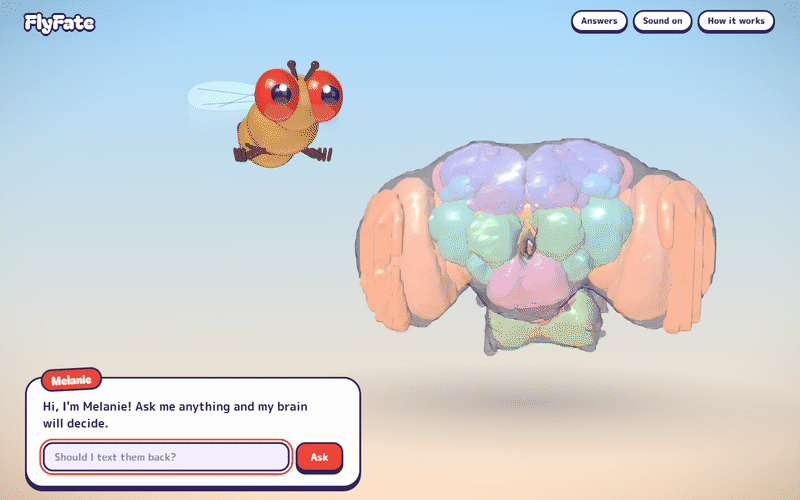
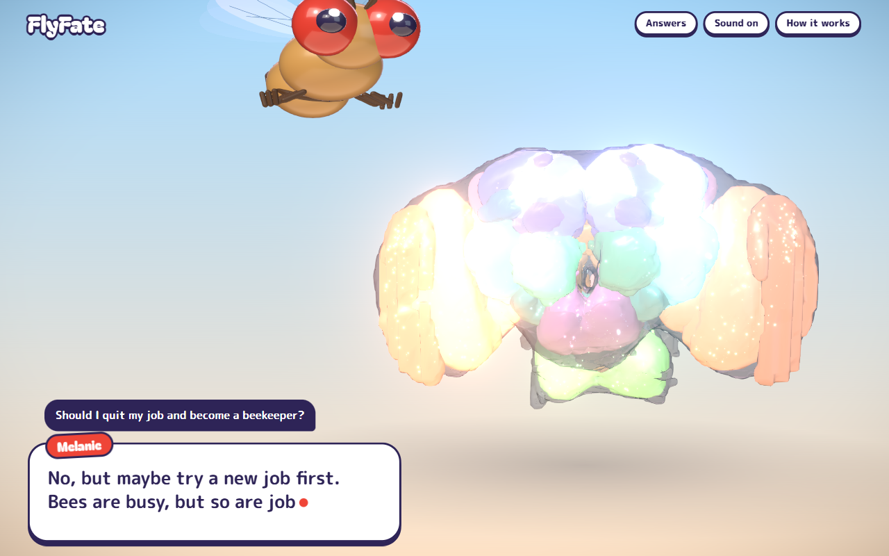
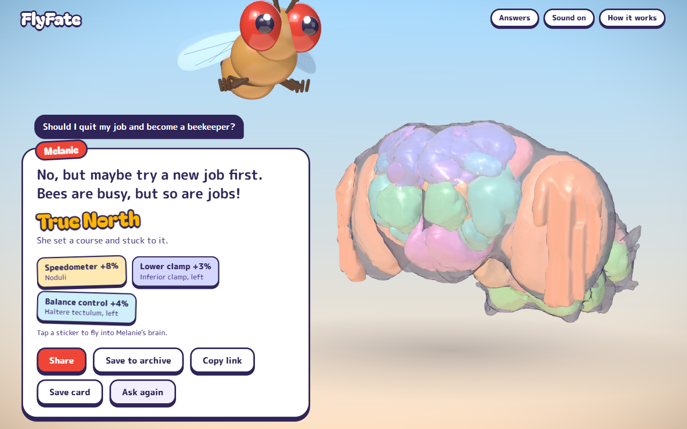
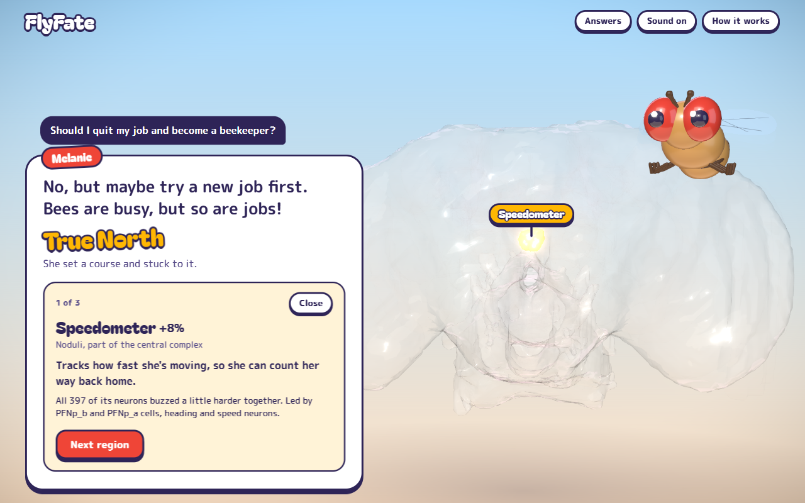
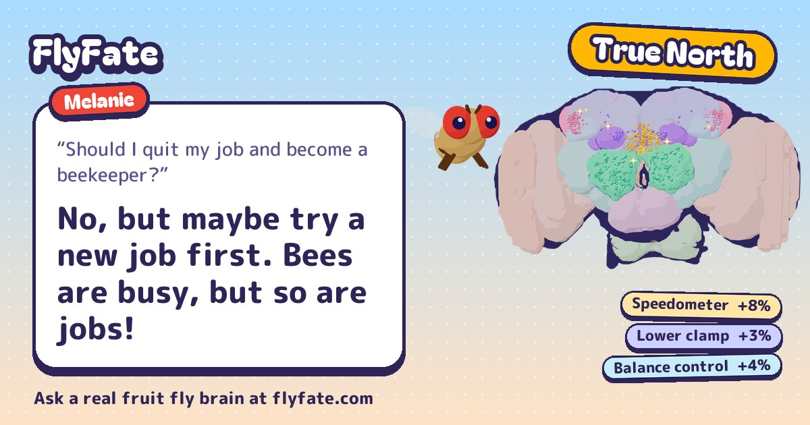
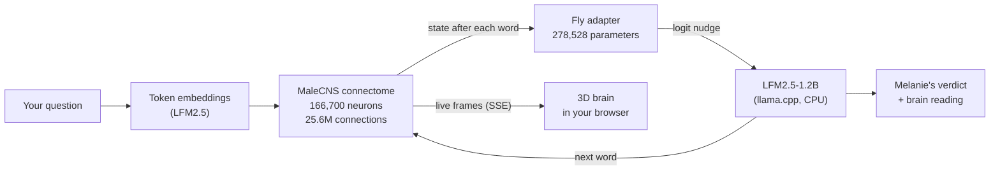

<div align="center">

# 🪰 FlyFate

### Ask a question. A real fruit fly brain decides.

Every word you type runs through the complete wiring diagram of a male fruit fly:<br>
**166,700 neurons, 25.6 million connections**, mapped synapse by synapse by the MaleCNS project.<br>
Then Melanie gives her verdict, and a 3D brain shows you where it rattled.

**[▶ Try it at flyfate.com](https://flyfate.com/?ref=github)**

[](https://flyfate.com/?ref=github) [](LICENSE) [](#credits-and-licenses)



</div>

---

## What happens when you ask

1. **Your question becomes signals.** Each word is turned into a vector and pushed into the fly's connectome, one step per word. The activity spreads along the real connections between real neurons.
2. **The brain lights up.** Your browser receives every step live and shows where it shakes things up more than in the rest of the brain. Every glowing bead is one real neuron, placed where its synapses are.
3. **Melanie answers.** A small language model writes the reply. After every word, a tiny trained adapter reads the fly brain's state and nudges which word comes next.
4. **You get a brain reading.** The regions that rattled most unusually, measured against how they behave across many other questions, with the real cell types that led. The strongest one names the decision type: *True North*, *Lookout*, *Gut Feeling* and more.
5. **Tap a sticker to fly inside.** The camera dives into that region and tells you what it does in a real fly.

<table>
<tr>
<td width="50%"><br><sub><b>Thinking.</b> Each frame is a real step through the connectome.</sub></td>
<td width="50%"><br><sub><b>The verdict.</b> Answer, decision type and the regions that stood out.</sub></td>
</tr>
<tr>
<td width="50%"><br><sub><b>Brain tour.</b> Fly into a region and meet the neurons that led.</sub></td>
<td width="50%"><br><sub><b>Share cards.</b> Every answer has a stable link and a 1200×630 preview card.</sub></td>
</tr>
</table>

## Does the fly brain actually do anything?

Barely, and we'd rather tell you than pretend. We trained the adapter on everyday conversations and tested on 24 held-back ones (perplexity, lower is better):

| Setup | Perplexity |
|---|---:|
| Language model alone | 3.807 |
| **With the fly brain adapter** | **3.716** |
| Same adapter, fly brain removed | 3.718 |
| Fly brain with neurons shuffled | 3.802 |

The adapter helps a little. The fly brain itself adds about nothing on top. That matches the authors of [FLM](https://github.com/nftechie/flm), the project this builds on: they found no evidence that the connectome improves the answers either. The adapter changes roughly one word in a hundred.

So FlyFate is a toy built on real science. The wiring is real, the activity you see is computed, the brain reading is measured. What Melanie *thinks* is a language model with a fly-shaped nudge. Same question, same answer, every time.

## How it works



- **Simulation** (`inference/src/fly_oracle_inference/sim.py`): FLM's reservoir over the MaleCNS graph, fed with LFM2.5 token embeddings (bf16, no PyTorch at runtime). About 26 ms per step on a CPU. Because FLM's input spreads every token over neurons across the whole brain, the display shows what rattles *more than the rest*, not raw activity.
- **Answers** (`oracle.py`): LFM2.5-1.2B-Instruct as a 4-bit GGUF in llama.cpp, plus the FLM adapter in NumPy. The adapter's correction is applied as `delta @ Eᵀ` through the tied output layer, only for the top 1,024 candidates. The answer is seeded by the question, so it is reproducible.
- **Server** (`server.py`): FastAPI streams every step as server-sent events and serves the web app. A fair queue keeps one question in the brain at a time; playback happens outside the queue.
- **Web** (`web/`): React 19, React Three Fiber and drei. Toon-shaded regions that wobble with activity, real neurons as beads, sparks along the strongest connections, a procedural mascot, synthesized sounds. No game engine, no textures.
- **Sharing** (`share.py`, `archive.py`): stable links per question, server-rendered pages with Open Graph cards drawn in Pillow, and a searchable archive of answers people chose to share.

## Run it locally

You need Python 3.12+ with [uv](https://docs.astral.sh/uv/), Node.js 24 and about 2 GB of disk space.

```bash
# Simulator and API (first start downloads ~1.3 GB of model and graph data, ~460 MB stay)
cd inference
uv sync
uv run uvicorn fly_oracle_inference.server:app --port 8000

# Web app, in a second terminal (proxies /api to port 8000)
cd web
npm install
npm run dev
```

Open http://localhost:5173 and ask away. Without the simulator running, the web app falls back to a clearly labelled demo mode.

Or run everything in one container:

```bash
docker build -t flyfate .
docker run -p 8000:8000 -v flyfate-data:/data flyfate
```

| Variable | Purpose |
|---|---|
| `FLY_ORACLE_HOME` | Where the downloaded data lives (default: `inference/`, `/data` in Docker) |
| `PUBLIC_URL` | Public origin for canonical links, cards and the sitemap |
| `LLM_THREADS` | llama.cpp threads (Docker default: 2) |
| `RESEND_API_KEY`, `MAIL_FROM` | Email links for saving answers. Without a key, links go to the server log |

### Rebuilding the brain data

The repo ships the small derived files (`inference/assets/`, `web/public/brain/`). To rebuild them from the raw connectome:

```bash
cd inference
uv run python scripts/build_brain_assets.py   # region meshes -> web/public/brain/brain.glb, regions.json
uv run python scripts/prepare_data.py         # neuron -> region map, beads, wiring (needs the 3 GB synapse table)
```

The adapter was trained once with FLM's `scripts/train_conversation.py` on the `everyday-conversations` corpus (about 11 minutes on a CPU).

## Privacy

Asking is private. Every answer has its own link, but it only appears in the archive and in search engines when someone shares it or saves it, and only if it is clean. Visits are counted without cookies: daily totals only, no IP addresses, no questions. The numbers are public at [flyfate.com/stats](https://flyfate.com/stats).

## Credits and licenses

| What | Source | License |
|---|---|---|
| Code in this repository | FlyFate | [MIT](LICENSE) |
| Brain data and everything derived from it (`brain_map.npz`, `reading_baseline.npz`, `web/public/brain/*`) | **MaleCNS v1.0** by [FlyEM / HHMI Janelia](https://www.janelia.org/project-team/flyem), University of Cambridge, MRC LMB and Google Research | [CC BY 4.0](https://creativecommons.org/licenses/by/4.0/) |
| Fly model (downloaded at runtime) | [FLM by nftechie](https://github.com/nftechie/flm) | MIT |
| Language model (downloaded at runtime) and the trained adapter (`adapter.npz`) | [LFM2.5-1.2B-Instruct by Liquid AI](https://huggingface.co/LiquidAI/LFM2.5-1.2B-Instruct) | [LFM Open License v1.0](https://huggingface.co/LiquidAI/LFM2.5-1.2B-Instruct/blob/main/LICENSE) |
| Fonts (`inference/assets/fonts/`) | Bagel Fat One, M PLUS Rounded 1c | SIL Open Font License |

Huge thanks to the FlyEM team and everyone who proofread 166,700 neurons by hand. FlyFate is a fan project and is not affiliated with any of them.

## Made by

**[@kimbo128](https://github.com/kimbo128)**, software engineer in Switzerland and author of **[AI Unfiltered](https://arturmarkus.com/?utm_source=github&utm_medium=referral&utm_campaign=flyfate)**, a blog about AI from a developer's point of view, including how projects like this one are built.

[](https://arturmarkus.com/?utm_source=github&utm_medium=referral&utm_campaign=flyfate) [](https://github.com/kimbo128)

<div align="center">
<br>

**[Ask Melanie something →](https://flyfate.com/?ref=github)**

<sub>If she made you smile, a ⭐ helps other people find her.</sub>

</div>
